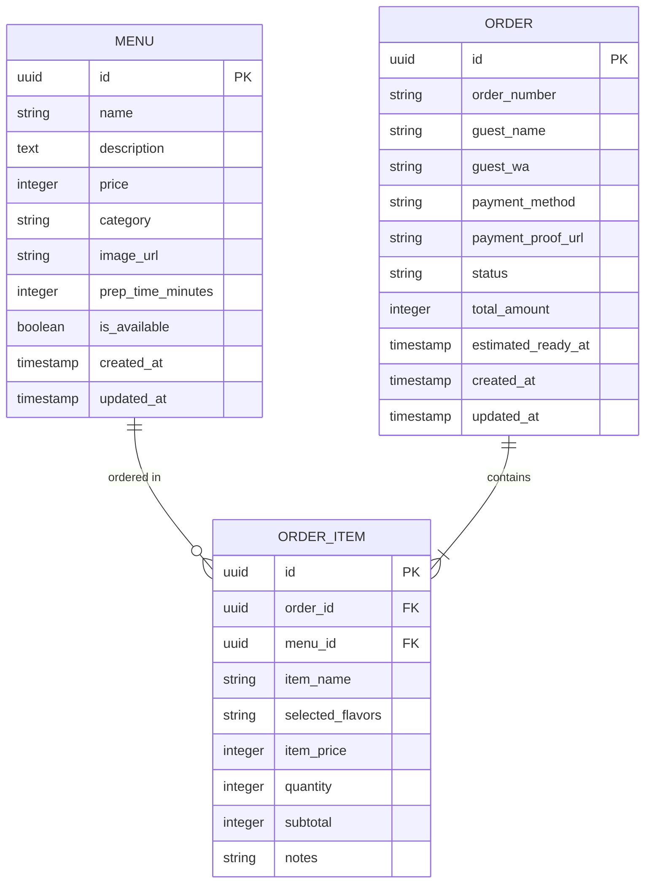
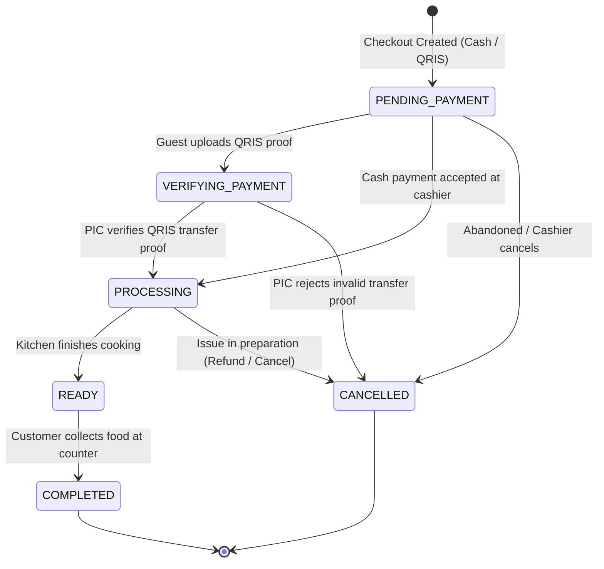

# Data Model Specification: DISPLAY Canteen MVP

**Feature**: `001-canteen-mvp`
**Date**: 2026-11-04
**Database**: PostgreSQL (Supabase Cloud)

## 1. Entity Relationship Diagram

---

## 2. Entities & Schema Definitions

### 2.1. `menus`
Represents food and drink items in the canteen catalog.

| Field | Type | Constraints | Description |
|---|---|---|---|
| `id` | `UUID` | PRIMARY KEY, default `gen_random_uuid()` | Unique menu identifier |
| `name` | `VARCHAR(100)` | NOT NULL | Item title (e.g. "Nasi Ayam Geprek") |
| `description` | `TEXT` | NULLABLE | Detailed description / ingredients |
| `price` | `INTEGER` | NOT NULL, `>= 0` | Price in IDR (e.g. `15000`) |
| `category` | `VARCHAR(50)` | NOT NULL | Category name ("Makanan", "Minuman", "Snack") |
| `image_url` | `VARCHAR(255)` | NULLABLE | URL or relative path to item photo |
| `prep_time_minutes`| `INTEGER` | NOT NULL, DEFAULT `5` | Base preparation time in minutes |
| `is_available` | `BOOLEAN` | NOT NULL, DEFAULT `TRUE` | Stock availability toggle |
| `created_at` | `TIMESTAMPTZ`| NOT NULL, DEFAULT `NOW()` | Timestamp created |
| `updated_at` | `TIMESTAMPTZ`| NOT NULL, DEFAULT `NOW()` | Timestamp last modified |

### 2.2. `orders`
Represents customer purchasing transactions and kitchen fulfillment lifecycle.

| Field | Type | Constraints | Description |
|---|---|---|---|
| `id` | `UUID` | PRIMARY KEY, default `gen_random_uuid()` | Unique order identifier |
| `order_number` | `VARCHAR(20)` | UNIQUE, NOT NULL | Short human-readable code (e.g. `ORD-101`) |
| `guest_name` | `VARCHAR(100)` | NOT NULL | Customer name entered at checkout |
| `guest_wa` | `VARCHAR(25)` | NOT NULL | Sanitized WhatsApp number (e.g. `628123456789`) |
| `payment_method` | `VARCHAR(20)` | NOT NULL | `'CASH'` or `'QRIS'` |
| `payment_proof_url`| `VARCHAR(255)`| NULLABLE | Cloud URL or storage path to receipt screenshot |
| `status` | `VARCHAR(30)` | NOT NULL, DEFAULT `'PENDING_PAYMENT'` | One of 6 canonical statuses |
| `total_amount` | `INTEGER` | NOT NULL, `>= 0` | Sum of all line item subtotals |
| `estimated_ready_at`| `TIMESTAMPTZ`| NULLABLE | Target completion time computed on `PROCESSING` |
| `created_at` | `TIMESTAMPTZ`| NOT NULL, DEFAULT `NOW()` | Order placement timestamp |
| `updated_at` | `TIMESTAMPTZ`| NOT NULL, DEFAULT `NOW()` | Order last updated timestamp |

### 2.3. `order_items`
Represents individual menu items included within an order.

| Field | Type | Constraints | Description |
|---|---|---|---|
| `id` | `UUID` | PRIMARY KEY, default `gen_random_uuid()` | Unique line-item identifier |
| `order_id` | `UUID` | FOREIGN KEY (`orders.id`) ON DELETE CASCADE | Parent order reference |
| `menu_id` | `UUID` | FOREIGN KEY (`menus.id`) ON DELETE RESTRICT | Menu item reference |
| `item_name` | `VARCHAR(100)` | NOT NULL | Base item name (e.g. "Roti Bakar") |
| `selected_flavors`| `VARCHAR(255)`| NOT NULL | Comma-separated or JSON flavors (e.g. "Cokelat, Keju") |
| `item_price` | `INTEGER` | NOT NULL, `>= 0` | Snapshot of item price at time of order |
| `quantity` | `INTEGER` | NOT NULL, `>= 1` | Quantity ordered |
| `subtotal` | `INTEGER` | NOT NULL, `>= 0` | `item_price * quantity` |
| `notes` | `VARCHAR(255)` | NULLABLE | Special requests (e.g., "pedas level 2", "tanpa es") |

---

## 3. Order Status State Machine

The order lifecycle adheres strictly to the **6 Canonical Statuses** specified in `DESIGN.md` and `PRD.md`:

### State Definitions & Rules

1. **`PENDING_PAYMENT`**: Order registered. Customer either owes cash at the counter or needs to scan QRIS and upload proof.
2. **`VERIFYING_PAYMENT`**: QRIS proof uploaded. Awaiting PIC verification on the admin dashboard.
3. **`PROCESSING`**: Payment verified. Order entered the kitchen preparation queue.
   - *Automated Trigger*: System calculates `estimated_ready_at` based on cumulative preparation time of queued orders.
4. **`READY`**: Food prepared.
   - *Operational Trigger*: PIC clicks "Kabari User", launching WhatsApp Web (`wa.me`) with a pre-filled pickup notification.
5. **`COMPLETED`**: Customer picked up food from the counter.
6. **`CANCELLED`**: Order aborted or rejected due to invalid payment proof or customer request.

---

## 4. Aggregated Views & Reporting Projections

### 4.1. Shift Sales Summary Projection
Generated on-demand via SQL aggregate query for `/api/reports/dashboard` and `/api/reports/export`:
- **Total Revenue**: `SUM(total_amount)` WHERE `status = 'COMPLETED'`
- **Order Count**: `COUNT(*)` grouped by status
- **Payment Method Split**: `COUNT(*)` and `SUM(total_amount)` grouped by `payment_method`
- **Top Selling Items**: `SUM(quantity)` and `SUM(subtotal)` grouped by `item_name`
