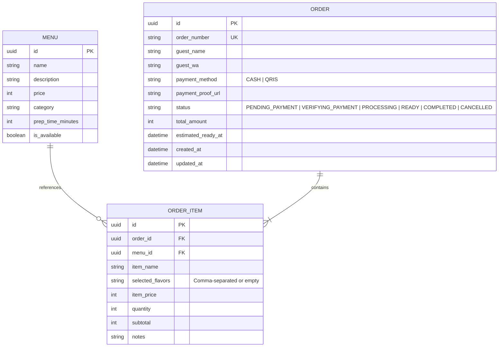

# Data Model & Schema Changes: Feature 002

**Feature**: `002-visual-and-queue`  
**Date**: 2026-11-05  

## 1. Schema & Model Adjustments

### Order & OrderItem Models
Existing models in `backend/app/models/` remain fundamentally sound and backward-compatible. Key behavioral adjustments:

1. **`OrderItem.selected_flavors`**:
   - Accepts empty list `[]` from payload.
   - When empty, `selected_flavors` is stored as `""` (empty string) and displayed in UI as `"Original (Polos)"`.
   - Max length remains 2.

2. **Order Lifecycle Transitions**:
   - Added valid transition: `PENDING_PAYMENT` -> `CANCELLED` triggered directly by the guest (self-service cancellation).
   - Any attempt to cancel an order currently in `PROCESSING`, `READY`, or `COMPLETED` is rejected with HTTP 400.

### Entity Relationship Diagram


---

## 2. API DTOs (Pydantic v2 Schemas)

### `OrderItemRequest`
```python
class OrderItemRequest(BaseModel):
    menu_id: UUID
    quantity: int = Field(default=1, ge=1)
    flavors: List[str] = Field(
        default_factory=list,
        max_length=2,
        description="Selected flavors (0 to 2 allowed). Empty means Roti Bakar Original."
    )
    notes: Optional[str] = None
```

### `PublicQueueItem`
```python
class PublicQueueItem(BaseModel):
    order_number: str
    guest_name: str
    status: str
    estimated_ready_at: Optional[datetime] = None

class PublicQueueResponse(BaseModel):
    processing: List[PublicQueueItem]
    ready: List[PublicQueueItem]
    server_time_wib: str
```
