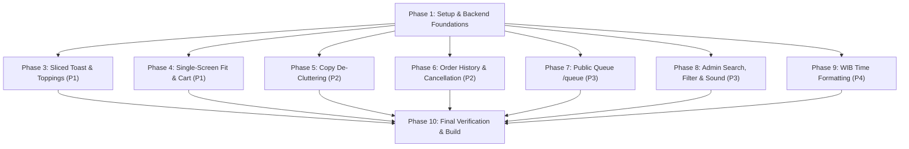

# Tasks: Visual Realism, Order Management & Public Queue Display

**Feature**: `002-visual-and-queue`  
**Status**: Ready for Implementation  
**Spec**: [spec.md](spec.md) | **Plan**: [plan.md](plan.md)  

---

## Dependencies & Execution Order

---

## Phase 1: Setup & Prerequisite Enhancements

- [x] **T001** [backend]: Create WIB timezone formatting utility in `backend/app/services/time_util.py` using `ZoneInfo("Asia/Jakarta")`.
- [x] **T002** [backend]: Update `backend/app/schemas/order.py` to allow empty `flavors: List[str] = Field(default_factory=list, max_length=2)` for 0-topping orders and define `PublicQueueResponse` and `PublicQueueItem` models.

---

## Phase 2: Core Backend Endpoints & Tests

- [x] **T003** [backend]: Implement `GET /api/orders/queue` in `backend/app/api/orders.py` returning active orders in `PROCESSING` and `READY` statuses with guest first name and order number.
- [x] **T004** [backend]: Implement `POST /api/orders/{id}/cancel` in `backend/app/api/orders.py` allowing self-cancellation strictly when status is `PENDING_PAYMENT`.
- [x] **T005** [backend]: Update `backend/app/api/reports.py` to format CSV export transaction timestamps in Asia/Jakarta (WIB).
- [x] **T006** [backend]: Add unit tests in `backend/tests/test_api.py` validating 0-topping order checkout, `POST /api/orders/{id}/cancel` (success and rejection when processing), and `GET /api/orders/queue`. Run `pytest`.

---

## Phase 3: User Story 1 - Realistic Sliced Toast Canvas & Authentic Topping Layers (P1)

- [x] **T007** [frontend]: Update `frontend/src/components/guest/RotiCustomizer.tsx` to render realistic sliced bread with warm golden crust edges, toasted browning gradients, and butter sheen.
- [x] **T008** [frontend]: Revamp `frontend/src/components/guest/ToppingLayer.tsx` to render authentic chocolate sprinkles (*meses*), dense curly shredded cheddar (*keju parut*), and glossy fruit/ganache jam spreads.
- [x] **T009** [frontend]: Implement 50:50 half-and-half SVG split layout in `ToppingLayer.tsx` using `clipPath` when two jam flavors (e.g. Strawberry + Blueberry) are active.
- [x] **T010** [frontend]: Implement layered rendering in `ToppingLayer.tsx` when a jam spread is combined with sprinkles or shredded cheese.
- [x] **T011** [frontend]: Update `frontend/src/pages/MenuPage.tsx` to initialize topping state with empty array `[]` and allow adding "Roti Bakar Original" to cart for flat Rp 6.000.

---

## Phase 4: User Story 2 - Single-Screen Fit Layout & High-Visibility Shopping Cart (P1)

- [x] **T012** [frontend]: Create `frontend/src/components/guest/CartBottomBar.tsx` featuring a high-contrast sticky blue bar with item count, total price, checkout CTA, and safe-area padding.
- [x] **T013** [frontend]: Refactor `frontend/src/components/guest/FlavorSelector.tsx` into a compact 6-swatch grid optimized for mobile screen heights.
- [x] **T014** [frontend]: Refactor `frontend/src/pages/MenuPage.tsx` to fit within standard mobile viewports (`100dvh`) without excessive scrolling, and integrate `CartBottomBar`.

---

## Phase 5: User Story 3 - UI Copy & Visual De-Cluttering (P2)

- [x] **T015** [frontend]: Update `frontend/src/components/common/Header.tsx` to remove "Meja Stand" badge and update subtitle to "Spesialis Roti Bakar" (removing "Hangat").
- [x] **T016** [frontend]: Remove top promotional banners and any "Fresh Toasted" copy from `MenuPage.tsx` and all user screens.

---

## Phase 6: User Story 4 - Customer Order History & Self-Service Cancellation (P2)

- [x] **T017** [frontend]: Create `frontend/src/components/guest/OrdersDrawer.tsx` displaying previous and active orders retrieved from `localStorage` (`display_canteen_guest`).
- [x] **T018** [frontend]: Add "Pesanan Saya" (Receipt icon) and Cart icon with counter badge in `Header.tsx`.
- [x] **T019** [frontend]: Add "Batalkan Pesanan" button in `frontend/src/pages/StatusPage.tsx` enabled only for `PENDING_PAYMENT` orders, connected to `api.cancelOrder()`.

---

## Phase 7: User Story 5 - Public Order Queue Display Screen (`/queue`) (P3)

- [x] **T020** [frontend]: Add `getPublicQueue()` method in `frontend/src/services/api.ts` and add public queue types in `frontend/src/types/index.ts`.
- [x] **T021** [frontend]: Create `frontend/src/pages/PublicQueuePage.tsx` with high-visibility large-typography columns for "Sedang Disiapkan" and "Siap Diambil", live WIB clock, and 8s auto-polling.
- [x] **T022** [frontend]: Register `/queue` route in `frontend/src/App.tsx`.

---

## Phase 8: User Story 6 - Admin Operations Suite (Search, Filter & Audio Chime) (P3)

- [x] **T023** [frontend]: Create `frontend/src/services/audio.ts` utilizing browser `AudioContext` to synthesize a gentle two-tone chime.
- [x] **T024** [frontend]: Create `frontend/src/components/admin/SearchFilterBar.tsx` with search input, Cash/QRIS toggle pills, and audio notification toggle.
- [x] **T025** [frontend]: Update `frontend/src/pages/AdminKanban.tsx` to integrate `SearchFilterBar`, filter cards dynamically, and play chime on new orders.

---

## Phase 9: User Story 7 - Standardized WIB Time Formatting (P4)

- [x] **T026** [frontend]: Create `frontend/src/services/time.ts` with `formatWIB()` utility and apply it across `StatusPage`, `AdminKanban`, `AdminReports`, and `PublicQueuePage`.

---

## Phase 10: Final Verification & Build

- [x] **T027** [verification]: Run `PYTHONPATH=. backend/venv/bin/pytest backend/tests/test_api.py` to confirm all backend tests pass.
- [x] **T028** [verification]: Run `npm --prefix frontend run build` to confirm zero TypeScript and bundle errors.
- [x] **T029** [docs]: Update `walkthrough.md` with complete implementation summary.
